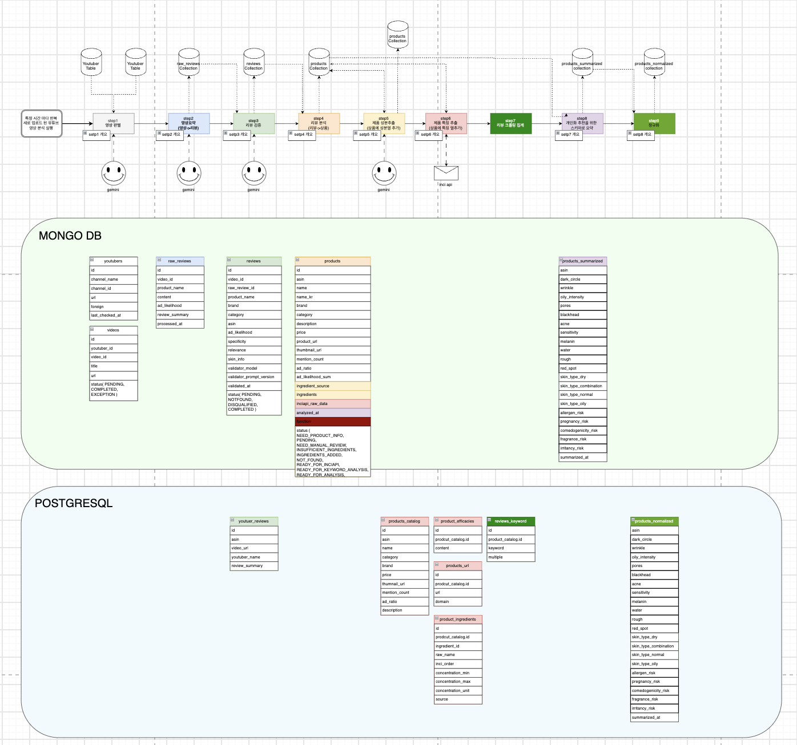

# seoulection data_pipeline

유튜브 K-뷰티 리뷰 영상을 매일 수집해, 제품별로 **피부 고민 효능 점수**를 산출하고
서비스 DB에 발행하는 데이터 파이프라인입니다.



## 흐름

| Step | 하는 일 | 결과 |
|---|---|---|
| 1 | 등록된 채널의 신규 영상 중 리뷰 영상 판별 | `videos` |
| 2 | 영상 → 언급 제품별 설명 + 광고 가능성 추출 | `raw_reviews` |
| 3 | 브랜드·카테고리 추출 + 리뷰 품질 채점 | `reviews` |
| 4 | 리뷰를 Amazon ASIN 단위 상품으로 집계 | `products` |
| 5 | 공식 소스에서 전성분(INCI) 수집 | `products.ingredients` |
| 6 | INCI API로 성분 효능·안전성 분석 → **Postgres 발행** | `products_catalog` 외 |
| 7 | 화해 리뷰 크롤링 + 키워드 집계 (Spark) | `reviews_keyword` |
| 8 | 효능 11종 · 피부타입 4종 · 리스크 5종 점수화 | `products_summarized` |
| 9 | 0~100 정규화 (Spark) | `products_normalized` |

- **MongoDB** = 파이프라인 작업 공간, **PostgreSQL** = 백엔드 API가 읽는 서빙 DB
- 중간에 **어드민 수동 확인**이 끼어듭니다 (제품 정보 입력 / 성분 보완 / 식약처 기능성 확인)
- Postgres 스키마는 백엔드 Flyway 소유 → 파이프라인은 DDL 없이 발행만 합니다

## 실행

```bash
pip install -r requirements.txt
python main.py
```

운영은 Prefect로 **매일 01:00 KST** 자동 실행됩니다 (`prefect.yaml`).
필요한 환경변수는 `prefect.yaml`의 `env` 블록 참고.
