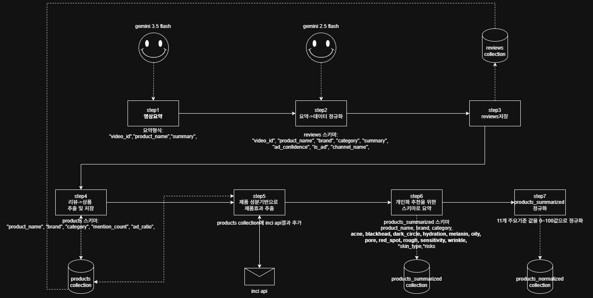

# data_pipeline

YouTube 스킨케어 영상을 분석해 제품별 피부 고민 효능 점수를 산출하는 데이터 파이프라인입니다.

## 파이프라인 흐름



```
YouTube URL
    │
    ▼
[Step 1] 영상 자막 추출 & Gemini 요약
    │
    ▼
[Step 2] 스킨케어 제품 정보 추출 (제품명 / 브랜드 / 카테고리 / 광고비율 / 언급횟수)
    │
    ▼
[Step 3] reviews 컬렉션 저장 (영상별 언급 제품 원본)
    │
    ▼
[Step 4] reviews 집계 → products 컬렉션 (광고 가중 점수 산출)
    │
    ▼
[Step 5] Gemini 웹서치로 INCI 성분 리스트 수집 + INCI API 분석 → products 업데이트
    │       (성분 10개 이하 제품은 신뢰도 낮아 INCI API 스킵)
    ▼
[Step 6] 효능·위험도 점수 계산 → products_summarized 컬렉션
    │       (11개 피부 고민 점수 / 4개 피부 타입 호환성 / 5개 위험도 플래그)
    ▼
[Step 7] 11개 피부 고민 점수 min-max 정규화(0~100) → products_normalized 컬렉션
```

## 환경 설정

### 필수 패키지 설치
```bash
pip install -r requirements.txt
```

### 환경 변수 (`.env`)
```
MONGODB_URI=mongodb+srv://...
MONGODB_DB_NAME=your_db_name
GEMINI_API_KEY=...
INCI_API_KEY=...
```

### YouTube URL 추가 (`urls.txt`)
```
# 주석은 #으로 시작
https://www.youtube.com/watch?v=XXXXXXXXX
https://www.youtube.com/watch?v=XXXXXXXXX
```

## 실행

```bash
python main.py
```

이미 처리된 영상은 자동으로 스킵됩니다.

## MongoDB 컬렉션 구조

| 컬렉션 | 설명 |
|--------|------|
| `reviews` | 영상별 언급 제품 원본 데이터 |
| `products` | 제품별 집계 + INCI 성분 분석 결과 |
| `products_summarized` | 11개 피부 고민 점수 + 위험도 + 피부 타입 호환성 (원본 점수) |
| `products_normalized` | `products_summarized`와 동일 스키마, 11개 피부 고민 점수만 0~100 정규화 |

## 출력 데이터 스키마 (`products_normalized`)

### 11개 피부 고민 점수 (0 ~ 100, 높을수록 해당 고민에 효과적)
| 필드 | 피부 고민 |
|------|----------|
| `dark_circle` | 다크서클 |
| `wrinkle` | 주름 |
| `oily` | 유분 |
| `pore` | 모공 |
| `blackhead` | 블랙헤드 |
| `acne` | 여드름 |
| `sensitivity` | 민감성 |
| `melanin` | 멜라닌(색소침착) |
| `hydration` | 수분 |
| `rough` | 거칠기 |
| `red_spot` | 홍조·붉은점 |

### 4개 피부 타입 호환성 (1.0 = 잘 맞음 / 0.5 = 보통 / 0.0 = 주의)
`skin_type_oily` / `skin_type_dry` / `skin_type_normal` / `skin_type_combination`

### 5개 위험도 플래그
| 필드 | 설명 |
|------|------|
| `irritancy_risk` | 자극 위험도 (0.0 ~ 1.0) |
| `comedogenicity_risk` | 모공 막힘 위험도 (0.0 ~ 1.0) |
| `fragrance_risk` | 향료 포함 여부 (0 / 1) |
| `allergen_risk` | 알레르기 유발 성분 포함 여부 (0 / 1) |
| `pregnancy_risk` | 임산부 주의 성분 포함 여부 (0 / 1) |
